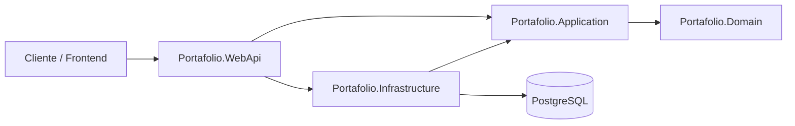
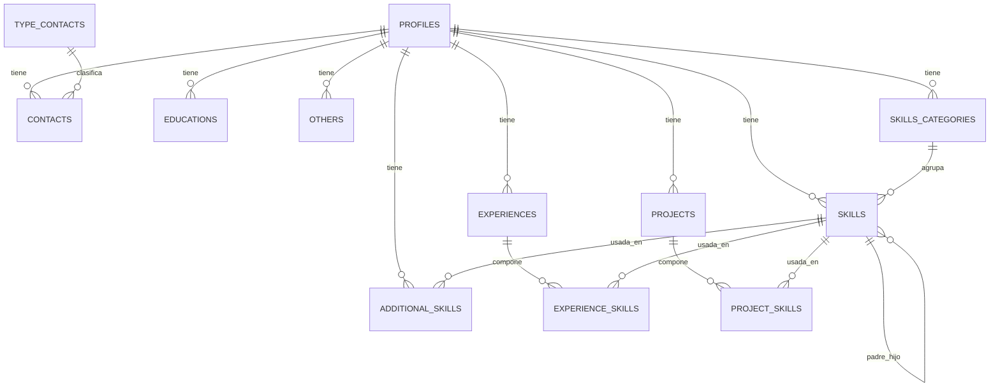

# API Portafolio


API REST desarrollada con **ASP.NET Core 8** que expone, en una sola respuesta, toda la información de un currículum/portafolio: perfil, contactos, educación, habilidades, experiencia laboral, proyectos, conocimientos adicionales y otra información complementaria.

El objetivo del proyecto es servir como backend del portafolio personal y, al mismo tiempo, aplicar de forma práctica una arquitectura por capas con patrones de diseño habituales en aplicaciones .NET.

---

## Características

- Endpoint único que compone el currículum completo de un perfil.
- Habilidades organizadas por categoría y con jerarquía padre/hijo ilimitada.
- Habilidades asociadas a experiencias, proyectos y conocimientos adicionales.
- Respuestas mediante DTOs, sin exponer entidades de persistencia.
- Filtrado de registros activos (soft delete) en todas las consultas.
- Documentación interactiva con Swagger/OpenAPI.
- Arquitectura por capas con inversión de dependencias.

---

## Stack tecnológico

| Tecnología | Uso |
|---|---|
| .NET 8 / ASP.NET Core | Framework de la API |
| Entity Framework Core 8 | Acceso a datos |
| Npgsql.EntityFrameworkCore.PostgreSQL | Proveedor de PostgreSQL |
| PostgreSQL | Base de datos |
| AutoMapper | Mapeo entidad → DTO |
| Swashbuckle.AspNetCore | Documentación Swagger/OpenAPI |

---

## Arquitectura

La solución está dividida en cuatro proyectos con dependencias unidireccionales:

```text
Portafolio.WebApi
├── Portafolio.Application
│   └── Portafolio.Domain
└── Portafolio.Infrastructure
    └── Portafolio.Application
```



### Responsabilidades por capa

| Proyecto | Responsabilidad |
|---|---|
| **Portafolio.WebApi** | Punto de entrada HTTP, controladores, configuración de Swagger, CORS y composición de dependencias. |
| **Portafolio.Application** | Contratos (interfaces de repositorios), DTOs y lógica de orquestación (`CurriculumService`). No conoce EF Core ni PostgreSQL. |
| **Portafolio.Domain** | Capa reservada para el modelo de dominio. Actualmente no contiene tipos propios. |
| **Portafolio.Infrastructure** | Implementación de repositorios, `DbContext`, entidades scaffolded, mapeos de AutoMapper y helpers de persistencia. |

### Regla de dependencias

- `Application` define las interfaces que necesita (`IProfileRepository`, `ICurriculumService`, etc.).
- `Infrastructure` las implementa.
- `WebApi` actúa como **composition root**: registra las implementaciones y conecta todo en `Program.cs`.

Esto permite que la lógica de aplicación no dependa de la base de datos y que las implementaciones puedan reemplazarse sin tocar los casos de uso.

### Flujo de una petición

```text
HTTP GET /api/v1/curriculum/{id}
        │
        ▼
CurriculumController
        │
        ▼
CurriculumService  ──►  IProfileRepository
        │               IContactRepository
        │               IEducationRepository
        │               ICategorySkillRepository
        │               IExperienceRepository
        │               IProjectSkillRepository
        │               IAdditionalSkillRepository
        │               IOtherRepository
        ▼
CurriculumDto (respuesta compuesta)
        │
        ▼
HTTP 200 OK / 404 Not Found
```

---

## Patrones y decisiones de diseño

### Repository

Cada agregado de lectura tiene su interfaz en `Application` y su implementación en `Infrastructure`. Los repositorios encapsulan las consultas de EF Core y devuelven DTOs, de modo que los controladores y servicios no dependen del modelo de persistencia.

### Service Layer

`CurriculumService` no contiene acceso a datos: solo orquesta las llamadas a los repositorios y compone el `CurriculumDto`. Esto mantiene el caso de uso aislado y facilita testearlo con mocks de las interfaces.

### DTO / Read Model

La API no expone entidades. Se usan DTOs específicos para cada sección (`ContactDto`, `SkillDto`, `ExperienceDto`, etc.) y un DTO agregado (`CurriculumDto`) que representa la respuesta completa del currículum.

### Dependency Injection

Cada capa expone su propio método de extensión:

- `AddApplication()` en `Portafolio.Application`.
- `AddInfrastructure()` en `Portafolio.Infrastructure`.
- `AddDbContextExtensions()`, `AddCorsExtensions()` y `AddSwaggerExtensions()` en `Portafolio.WebApi`.

`Program.cs` queda como un punto de composición limpio y legible.

### Proyección y `AsNoTracking`

- Las consultas de solo lectura usan `AsNoTracking()` para evitar el tracking innecesario.
- Los mapeos simples usan `ProjectTo<T>()` de AutoMapper, que traduce el mapeo a SQL.
- Los DTOs con lógica adicional (por ejemplo, árboles de habilidades o fechas formateadas) usan proyección explícita en memoria después de cargar solo lo necesario.

### Soft delete

Las entidades incluyen `IsActive` y `DeletedAt`. Las consultas filtran siempre por `IsActive`, por lo que los registros se desactivan en lugar de eliminarse físicamente. Esto preserva el historial y evita romper relaciones.

### Jerarquía de habilidades

`Skill` se relaciona consigo misma mediante `FatherId`. El helper `SkillTreeBuilder` (en `Infrastructure/Common`) transforma una lista plana de skills en un árbol de `SkillDto`:

- `Build(skills)` construye el árbol desde las raíces (`FatherId == null`).
- `BuildSubtree(skills, rootId)` construye el árbol desde una skill concreta, incluyendo a sus descendientes.

Se ubica en `Infrastructure` porque trabaja con la entidad de persistencia `Skill`; ponerlo en `Application` obligaría a esa capa a depender de EF Core.

### Base de datos primero

El modelo de persistencia se generó con `dotnet ef dbcontext scaffold` (enfoque *database-first*). Por eso las entidades viven en `Infrastructure` y no en `Domain`. Es una decisión pragmática: el esquema es la fuente de verdad y el scaffold mantiene las entidades sincronizadas con PostgreSQL.

> **Nota de arquitectura:** en una implementación *Clean Architecture* estricta, las entidades de dominio vivirían en `Portafolio.Domain`. Aquí se priorizó el enfoque database-first para mantener el esquema y el código alineados con poco esfuerzo.

---

## Modelo de datos



### Entidades principales

| Entidad | Descripción |
|---|---|
| `Profile` | Datos principales del perfil. |
| `Contact` / `TypeContact` | Contactos y su clasificación (teléfono, correo, URL). |
| `Education` | Formación académica y certificaciones. |
| `Experience` / `ExperienceSkill` | Experiencia laboral y habilidades asociadas con meses de uso. |
| `Project` / `ProjectSkill` | Proyectos y habilidades utilizadas. |
| `SkillsCategory` / `Skill` | Categorías y habilidades con jerarquía padre/hijo. |
| `AdditionalSkill` | Conocimientos adicionales con contenido descriptivo y skill asociada. |
| `Other` | Información complementaria (idiomas, ubicación, disponibilidad, etc.). |

---

## API

### Obtener el currículum de un perfil

```http
GET /api/v1/curriculum/{id}
```

| Parámetro | Tipo | Descripción |
|---|---|---|
| `id` | `Guid` | Identificador del perfil. |

**Respuestas**

- `200 OK`: currículum completo.
- `404 Not Found`: el perfil no existe o está inactivo.

La respuesta es un objeto `CurriculumDto` con las secciones `profile`, `contact`, `education`, `categorySkill`, `experience`, `projectSkill`, `additionalSkill` y `other`. Los nombres y tipos de cada campo se pueden consultar en Swagger.

---

## Puesta en marcha

### Requisitos

- [.NET 8 SDK](https://dotnet.microsoft.com/download/dotnet/8.0)
- PostgreSQL 13 o superior
- `dotnet-ef` (solo si vas a regenerar el scaffold)

### 1. Crear la base de datos

Crea la base de datos `portafolio` y ejecuta el script `seed.sql` del repositorio del frontend/portafolio para cargar el esquema y los datos de ejemplo.

### 2. Configurar la conexión

Edita `Portafolio.WebApi/appsettings.json`:

```json
{
  "ConnectionStrings": {
    "DefaultConnection": "Host=localhost;Port=5432;Database=portafolio;Username=usr_portafolio;Password=secret"
  }
}
```

### 3. Restaurar y ejecutar

```bash
dotnet restore
dotnet build
dotnet run --project Portafolio.WebApi
```

La API queda disponible en:

- HTTP: `http://localhost:5141`
- HTTPS: `https://localhost:7184`
- Swagger UI: `https://localhost:7184/swagger`

---

## Scaffold de la base de datos

El proyecto usa el enfoque *database-first*. Si el esquema cambia, regenera las entidades y el contexto:

```bash
dotnet tool install --global dotnet-ef --version 8.0.27

dotnet ef dbcontext scaffold "Host=localhost;Port=5432;Database=portafolio;Username=usr_portafolio;Password=secret" Npgsql.EntityFrameworkCore.PostgreSQL --project Portafolio.Infrastructure --startup-project Portafolio.WebApi --context PortafolioDbContext --context-dir Persistence/Contexts --output-dir Persistence/Entities --no-onconfiguring --force
```

> El scaffold sobrescribe las entidades. Cualquier ajuste manual en ellas debe revisarse después de regenerar.

### Paquetes utilizados

```bash
dotnet add Portafolio.Infrastructure package Microsoft.EntityFrameworkCore
dotnet add Portafolio.Infrastructure package Microsoft.EntityFrameworkCore.Design
dotnet add Portafolio.Infrastructure package Npgsql.EntityFrameworkCore.PostgreSQL
dotnet add Portafolio.Infrastructure package AutoMapper.Extensions.Microsoft.DependencyInjection

dotnet add Portafolio.WebApi package Microsoft.EntityFrameworkCore.Design
dotnet add Portafolio.WebApi package Swashbuckle.AspNetCore
```

---

## Convenciones del código

- **Nullable e ImplicitUsings** habilitados en todos los proyectos.
- **Primary constructors** en repositorios y servicios para reducir código repetitivo.
- **Collection expressions** (`[]`) para inicializar listas.
- **Soft delete**: filtrar siempre por `IsActive` en las consultas.
- **Sin entidades en las respuestas**: toda salida pasa por un DTO.
- **Consultas de lectura** con `AsNoTracking()`.
- **Comentarios XML** en los tipos públicos de la API para alimentar Swagger.

---

## Estructura del repositorio

```text
portafolio-backend/
├── Portafolio.Domain/
├── Portafolio.Application/
│   ├── DTOs/
│   ├── Interfaces/
│   ├── Services/
│   └── DependencyInjection.cs
├── Portafolio.Infrastructure/
│   ├── Common/
│   │   └── SkillTreeBuilder.cs
│   ├── Mappings/
│   │   └── MappingProfile.cs
│   ├── Persistence/
│   │   ├── Contexts/
│   │   └── Entities/
│   ├── Repositories/
│   └── DependencyInjection.cs
├── Portafolio.WebApi/
│   ├── Controllers/V1/
│   ├── Extensions/
│   ├── Program.cs
│   └── appsettings.json
└── portafolio-backend.sln
```

---

## Estado del proyecto

- [x] API de currículum completa.
- [x] Habilidades jerárquicas por categoría, experiencia, proyecto y conocimiento adicional.
- [x] Documentación Swagger.
- [ ] Pruebas unitarias e integración.
- [ ] Autenticación y autorización.
- [ ] Endpoints de escritura (CRUD).
- [ ] Migraciones de EF Core (actualmente se usa scaffold).
